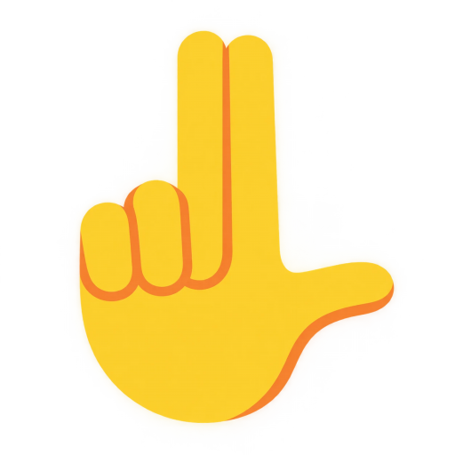
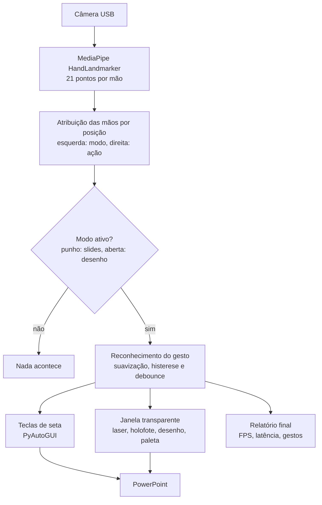

# GestureDeck

Controle uma apresentação do PowerPoint com as mãos, usando só uma câmera comum. Projeto da disciplina **Cognitive Computing, Computer Vision and IoT Systems** (FIAP), Checkpoint 3.

O apresentador fica de pé, longe do computador. A câmera acompanha as duas mãos em tempo real com o MediaPipe, e o programa desenha o laser e as anotações numa janela transparente sobre a tela, que também aparece para quem assiste remotamente (compartilhando a tela inteira). Não é preciso mouse, teclado nem passador de slides.

## Gestos

A **mão esquerda**, levantada, escolhe o modo. A **mão direita** age dentro dele.

| | Gesto | Ação |
|:---:|---|---|
|  | Mão esquerda fechada e levantada | **Modo slides** |
|  | Mão esquerda aberta e levantada | **Modo desenho** |
|  | Mão direita com o indicador esticado | **Laser**, nos dois modos |
|  | Pinça de polegar e indicador, movendo a mão | **Desenhar**, no modo desenho |
|  | Indicador e médio para cima, polegar dobrado, parado por cerca de 0,35 s | **Slide seguinte**, no modo slides |
|  | Mesmo gesto, com o polegar aberto para o lado (L) | **Slide anterior**, no modo slides |

- **Sem modo, nada acontece.** Isso evita acionar algo sem querer quando o apresentador gesticula ao falar.
- **Cada modo bloqueia só o gesto do outro:** a pinça é ignorada no modo slides, então fechar os dedos para trocar de slide não risca a tela, e os dois dedos não trocam de slide no modo desenho. Ao trocar de modo, o gesto em andamento é descartado.
- **Cursor:** com um modo ativo, um holofote pequeno acompanha a mão direita, mostrando onde o laser aponta e onde o traço começa. Se a mão direita sair da câmera, o indicador na tela avisa.
- **Paleta:** no modo desenho, uma barra na borda da tela oferece cores, borracha, desfazer e limpar. Para escolher, mantenha o laser parado sobre o item por cerca de 1 segundo.
- **Teclas:** **F1** cartão de ajuda, **F2** laser ou holofote, **F9** pausar, **F10** sair.

## Como funciona



- **Mãos por posição:** de duas mãos, a mais à esquerda na imagem espelhada é a que escolhe o modo. O rótulo esquerda/direita do MediaPipe não é usado, e cada mão é acompanhada pela posição anterior, então os papéis não se invertem se elas se cruzarem.
- **Dedo esticado sem depender da direção ou da distância:** a ponta precisa estar mais longe do pulso que a articulação do meio, com as medidas divididas pelo tamanho da mão.
- **Pinça e slide:** a pinça usa histerese (fecha em 0,30, abre em 0,50) e debounce. A troca de slide é um gesto parado, que dispara uma vez e só repete depois de sair do gesto, com no mínimo 1 s entre trocas. O polegar decide o sentido, e uma posição intermediária é ignorada.
- **Ponteiro:** a posição da mão vira posição na tela por uma zona ativa, com suavização pelo filtro 1 euro.
- **Janela transparente:** sem borda, sempre no topo, os cliques atravessam e o foco continua no PowerPoint. A visão roda em uma thread e o desenho em outra.

## Como executar

Requisitos: Windows, Python 3.10, câmera USB fixa e PowerPoint. Clone em uma pasta curta (por exemplo `C:\dev\GestureDeck`), porque caminhos longos quebram o Git no Windows.

```bash
git clone https://github.com/LuanRodrigues15/GestureDeck.git
cd GestureDeck
py -3.10 -m venv .venv
.venv\Scripts\activate
pip install -r requirements.txt
python scripts/baixar_modelo.py
python main.py
```

Abra a apresentação no PowerPoint e inicie com F5. A seta é enviada para a janela da apresentação, que vem para a frente se outra janela estiver em foco. Só uma cópia roda por vez, porque duas disputam a câmera. Para fechar, use F10, o ícone da bandeja (botão direito, "Sair") ou `python main.py --encerrar`.

| Opção | O que faz |
|---|---|
| `--ensaio` | mostra a ação na tela sem enviar teclas |
| `--previa` | abre uma janela com a câmera, os pontos das mãos e a zona ativa |
| `--depurar` | grava em `relatorios/` um log do que a câmera vê, a cada 0,5 s |
| `--camera N` | escolhe a câmera |
| `--monitor N` | escolhe o monitor do overlay (tela estendida) |
| `--sem-overlay` | abre só a prévia, sem a janela transparente |
| `--simular` | usa gestos simulados no lugar da câmera |
| `--encerrar` | fecha o GestureDeck em execução e libera a câmera |

Ao sair com F10, um relatório em JSON (slides trocados, traços, gestos reconhecidos, FPS e latência) é salvo em `relatorios/`. Limites, tempos, cores e zona ativa ficam no `config.json`.

### Ajuste na primeira vez

1. Rode `python main.py --ensaio --previa` no lugar onde vai apresentar. O retângulo verde é a zona ativa; ajuste `mapeamento.zona_ativa` para a área em que a mão direita se move com conforto.
2. Se nenhum modo ativar, confira `gestos.trava_altura_max` (quanto maior, mais baixo a mão esquerda pode ficar). A mão aberta exige os quatro dedos esticados; se falhar, ajuste `gestos.dedo_esticado_limiar`.
3. Se o polegar trocar o sentido do slide, ajuste `slide.polegar_dobrado_max` e `slide.polegar_esticado_min`.
4. Se a câmera não abrir, feche navegador e Discord (ela atende um programa por vez) ou use `--camera N`. Em sala escura o FPS cai: acenda a luz ou defina `camera.exposicao` (por exemplo `-5`).

### Testes

```bash
python -m unittest discover -s tests
```

Os testes usam mãos sintéticas, sem câmera, e cobrem os modos, o laser, a pinça, a troca de slide, a paleta e o desenho.

## Tecnologias

Python 3.10, OpenCV, MediaPipe (HandLandmarker), PySide6 (janela transparente), PyAutoGUI (teclas de seta) e NumPy, com as versões fixadas no `requirements.txt`.

## Apresentação

Os slides usados para apresentar o projeto estão em [`apresentacao/GestureDeck_apresentacao.pptx`](apresentacao/GestureDeck_apresentacao.pptx). Eles foram pensados para serem passados com o próprio GestureDeck.

## Referências e créditos

- [kazuhito00/hand-gesture-recognition-using-mediapipe](https://github.com/kazuhito00/hand-gesture-recognition-using-mediapipe) (Apache-2.0): uso dos 21 pontos e normalização pelo pulso.
- [TechBot505/Gesture-Controlled-Presentation](https://github.com/TechBot505/Gesture-Controlled-Presentation): controle de slides por gestos e overlay sobre o PowerPoint real.
- [wayscriber](https://github.com/devmobasa/wayscriber) e [Projecteur](https://github.com/jahnf/projecteur) (MIT): laser com rastro, holofote e anotação sobre a tela.
- [1€ Filter](https://github.com/jaantollander/oneeurofilter) (MIT): suavização do ponteiro.
- [MediaPipe Hand Landmarker](https://ai.google.dev/edge/mediapipe/solutions/vision/hand_landmarker) (Google): detecção das mãos.
- [Twemoji](https://github.com/jdecked/twemoji) (CC-BY 4.0): ícones de mão em `assets/icones/`, detalhes em `assets/icones/LICENCA.md`. O ícone do slide anterior foi feito pelo grupo.

## Integrantes

Luan Rodrigues, João Henrique e Mateus Henrique
