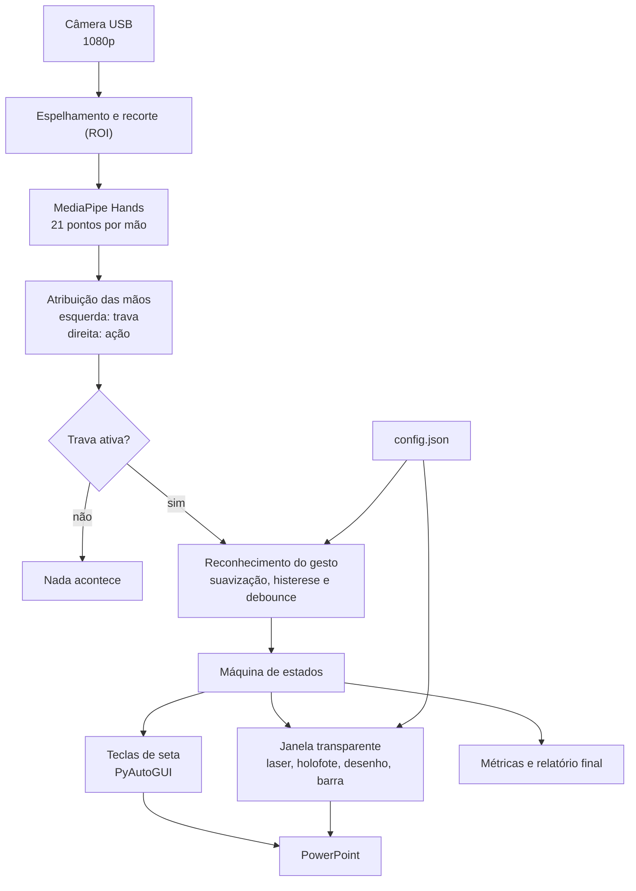

# GestureDeck

Projeto da disciplina **Cognitive Computing, Computer Vision and IoT Systems** (FIAP), Checkpoint 3.

## Descrição do projeto

O **GestureDeck** é um programa que permite controlar uma apresentação do PowerPoint com as mãos, usando uma câmera comum. O apresentador fica de pé, longe do computador, e com a **mão direita** aponta um laser na tela, desenha sobre o slide e passa os slides para frente ou para trás. Os comandos só funcionam enquanto a **mão esquerda** está fechada e levantada, o que evita acionar algo sem querer quando ele gesticula ao falar.

A câmera acompanha as duas mãos em tempo real com o MediaPipe. O laser e os desenhos aparecem numa janela transparente sobre a tela, por isso também são vistos por quem assiste a apresentação remotamente (compartilhando a tela inteira). Assim, não é preciso mouse, teclado nem passador de slides.

## Gestos

| Ação | Gesto |
|---|---|
| Habilitar os comandos (trava) | Mão esquerda fechada e levantada, mantida |
| Laser | Mão direita com o indicador esticado, como o número 1 |
| Desenhar | Pinça (polegar e indicador) mantida, movendo a mão |
| Slide seguinte | Mão direita aberta, deslizando para a esquerda |
| Slide anterior | Mão direita aberta, deslizando para a direita |

Enquanto a trava está ativa, uma barra na borda da tela permite escolher a cor, usar a borracha, desfazer e limpar o desenho, bastando manter o laser parado sobre o item por cerca de 1 segundo. Teclas: **F1** cartão de ajuda, **F2** laser ou holofote, **F9** pausar, **F10** sair.

## Tecnologias

Python 3.10, OpenCV, MediaPipe Hands, PySide6 (janela transparente), PyAutoGUI (teclas de seta) e NumPy.

## Diagrama de funcionamento



## Como executar (previsto)

Requisitos: Windows, Python 3.10, câmera USB fixa e PowerPoint.

```bash
git clone <url-do-repositorio>
cd GestureDeck
py -3.10 -m venv .venv
.venv\Scripts\activate
pip install -r requirements.txt
python main.py        # use --ensaio para testar sem enviar teclas
```

## Integrantes

Luan Rodrigues, João Henrique e Mateus Henrique
