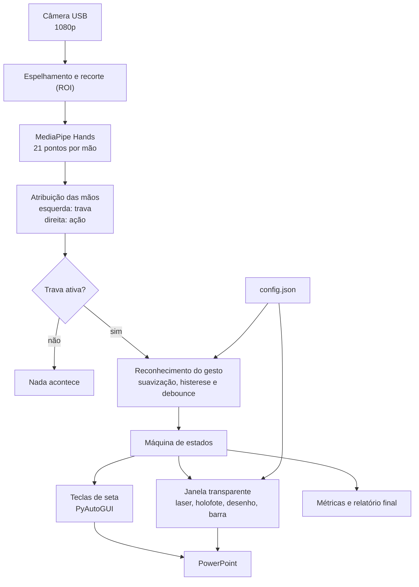

# GestureDeck

Projeto da disciplina **Cognitive Computing, Computer Vision and IoT Systems** (FIAP), Checkpoint 3.

## Descrição do projeto

O **GestureDeck** é um programa que permite controlar uma apresentação do PowerPoint com as mãos, usando uma câmera comum. O apresentador fica de pé, longe do computador, e com a **mão direita** aponta um laser na tela, desenha sobre o slide e passa os slides para frente ou para trás. Os comandos só funcionam enquanto a **mão esquerda** está fechada e levantada, o que evita acionar algo sem querer quando ele gesticula ao falar.

A câmera acompanha as duas mãos em tempo real com o MediaPipe. O laser e os desenhos aparecem numa janela transparente sobre a tela, por isso também são vistos por quem assiste a apresentação remotamente (compartilhando a tela inteira). Assim, não é preciso mouse, teclado nem passador de slides.

## Gestos

| Ação | Gesto |
|---|---|
| Habilitar os comandos (trava) | Mão esquerda fechada e levantada, mantida |
| Laser | Mão direita com o indicador esticado, como o número 1 |
| Desenhar | Pinça (polegar e indicador) mantida, movendo a mão |
| Slide seguinte | Mão direita aberta, deslizando para a esquerda |
| Slide anterior | Mão direita aberta, deslizando para a direita |

Com a trava ativa, um holofote pequeno acompanha a mão direita como o cursor de um mouse, mostrando onde o laser vai apontar e onde o traço vai começar. Ele ganha a cor da caneta quando você desenha e some quando a mão está aberta para deslizar.

Enquanto a trava está ativa, uma barra na borda da tela permite escolher a cor, usar a borracha, desfazer e limpar o desenho, bastando manter o laser parado sobre o item por cerca de 1 segundo. Teclas: **F1** cartão de ajuda, **F2** laser ou holofote, **F9** pausar, **F10** sair.

## Tecnologias

Python 3.10, OpenCV, MediaPipe (HandLandmarker, 21 pontos por mão), PySide6 (janela transparente), PyAutoGUI (teclas de seta) e NumPy. As versões estão fixadas no `requirements.txt`.

## Como funciona

- **Trava por posição:** de duas mãos, a mais à esquerda na imagem espelhada é a trava e a outra age. O rótulo esquerda/direita do MediaPipe não é usado.
- **Dedo esticado sem depender da direção:** a ponta precisa estar mais longe do pulso que a articulação do meio, com as distâncias divididas pelo tamanho da mão. Assim os limiares valem perto e longe da câmera.
- **Pinça:** distância polegar-indicador normalizada, com histerese (fecha em 0,30 e abre em 0,50) e debounce de cerca de 0,3 s.
- **Ponteiro relativo:** a posição da mão vira posição na tela por uma zona ativa, com suavização exponencial adaptativa (filtro 1 euro). A âncora é a base do indicador, não a ponta, porque a ponta se mexe na pinça.
- **Deslize:** palma aberta que percorre cerca de 3 tamanhos de mão em até 0,6 s. Depois do comando há 1 s de espera para o retorno da mão não virar o comando contrário.
- **Janela transparente:** sem borda, sempre no topo, cliques atravessam e o foco continua no PowerPoint. A visão roda em uma thread e o desenho em outra.

## Como executar

Requisitos: Windows, Python 3.10, câmera USB fixa e PowerPoint. Clone em uma pasta curta (por exemplo `C:\dev\GestureDeck`), porque caminhos longos quebram o Git no Windows.

```bash
git clone https://github.com/LuanRodrigues15/GestureDeck.git
cd GestureDeck
py -3.10 -m venv .venv
.venv\Scripts\activate
pip install -r requirements.txt
python scripts/baixar_modelo.py
python main.py
```

Abra a apresentação no PowerPoint e inicie com F5. Com a tela duplicada no projetor, o overlay aparece nas duas saídas. Com a tela estendida, use `--monitor N` para escolher o monitor onde a apresentação roda.

Opções:

| Opção | O que faz |
|---|---|
| `--ensaio` | mostra a ação na tela sem enviar teclas |
| `--previa` | abre uma janela com a câmera, os pontos das mãos e os valores usados no reconhecimento |
| `--sem-overlay` | não cria a janela transparente (abre só a prévia) |
| `--camera N` | escolhe a câmera |
| `--monitor N` | escolhe o monitor do overlay |
| `--simular` | usa gestos simulados no lugar da câmera, para testar o overlay |

Os parâmetros (limites, tempos, cores, zona ativa, sentido do deslize) ficam no `config.json`. Ao encerrar com F10, um relatório em JSON (slides trocados, traços, gestos reconhecidos, FPS e latência) é salvo na pasta `relatorios/`.

### Ajuste na primeira vez

1. Rode `python main.py --ensaio --previa` e fique no lugar onde vai apresentar.
2. O retângulo verde na prévia é a zona ativa. Ajuste `mapeamento.zona_ativa` no `config.json` para a área em que sua mão direita se move com conforto.
3. Se a trava não ativar, confira `gestos.trava_altura_max` (quanto mais alto o valor, mais baixo a mão esquerda pode ficar).
4. Em ambiente escuro a câmera pode cair de FPS. Acenda a luz ou defina `camera.exposicao` (por exemplo `-5`).

### Testes

```bash
python -m unittest discover -s tests
```

Os testes usam mãos sintéticas, sem câmera, e cobrem a trava, o laser, a pinça, o deslize, a barra e o desenho.

## Referências

Projetos open source usados como base de ideias:

- [kazuhito00/hand-gesture-recognition-using-mediapipe](https://github.com/kazuhito00/hand-gesture-recognition-using-mediapipe) (Apache-2.0): uso dos 21 pontos e normalização pelo pulso.
- [TechBot505/Gesture-Controlled-Presentation](https://github.com/TechBot505/Gesture-Controlled-Presentation): controle de slides por gestos, comparação com a nossa trava e o overlay sobre o PowerPoint real.
- [wayscriber](https://github.com/devmobasa/wayscriber) e [Projecteur](https://github.com/jahnf/projecteur) (MIT): laser com rastro, holofote e janela de anotação sobre a tela.
- [1€ Filter](https://github.com/jaantollander/oneeurofilter) (MIT): suavização do ponteiro.
- [MediaPipe Hand Landmarker](https://ai.google.dev/edge/mediapipe/solutions/vision/hand_landmarker) (Google): modelo de detecção das mãos.

## Diagrama de funcionamento



## Integrantes

Luan Rodrigues, João Henrique e Mateus Henrique
