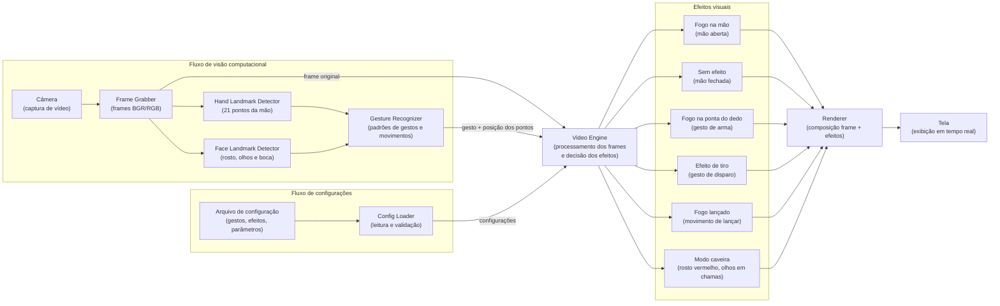

# awesome-flame

## Descrição do projeto

O **awesome-flame** é um programa que usa o vídeo capturado pela câmera para identificar os movimentos e gestos das mãos do usuário e aplicar efeitos visuais em tempo real, de acordo com o gesto reconhecido.

Gestos e efeitos previstos:

| Gesto | Efeito |
| --- | --- |
| Mão aberta | Gera um efeito de fogo na mão |
| Mão fechada | Interrompe o efeito de fogo |
| Gesto de arma | Posiciona o fogo na ponta do dedo |
| Gesto de disparo | Reproduz um efeito visual de tiro |
| Movimento de lançar fogo | O fogo é lançado a partir da mão |
| Mão aberta com fogo levada à boca (movimento de comer) | Ativa o modo caveira: o rosto fica vermelho, os olhos pegam fogo e o usuário se transforma em caveira, inspirado no Motoqueiro Fantasma |

## Diagrama de funcionamento

O diagrama abaixo mostra o fluxo interno do programa, da captura da imagem até a exibição dos efeitos na tela. O fluxo de visão computacional (captura, detecção dos pontos da mão e reconhecimento de gestos) e o fluxo de configurações convergem no **Video Engine**, que processa os frames e decide quais efeitos aplicar.

### Etapas

1. **Captura**: a câmera fornece o vídeo e o Frame Grabber entrega um frame por vez.
2. **Identificação**: o Hand Landmark Detector localiza os pontos da mão em cada frame. O Face Landmark Detector localiza o rosto, os olhos e a boca, necessários para o modo caveira.
3. **Reconhecimento**: o Gesture Recognizer interpreta a posição dos pontos, ao longo de vários frames, e identifica o gesto ou movimento (mão aberta, mão fechada, arma, disparo, lançar fogo, comer com a mão aberta e fogo ativo).
4. **Configuração**: em paralelo, o Config Loader carrega as configurações do sistema (mapeamento de gestos para efeitos, intensidade, cores, etc.).
5. **Processamento**: o Video Engine recebe o frame, o gesto e as configurações, e determina qual efeito aplicar e onde.
6. **Renderização**: o Renderer combina o frame com o efeito escolhido e exibe o resultado na tela.
